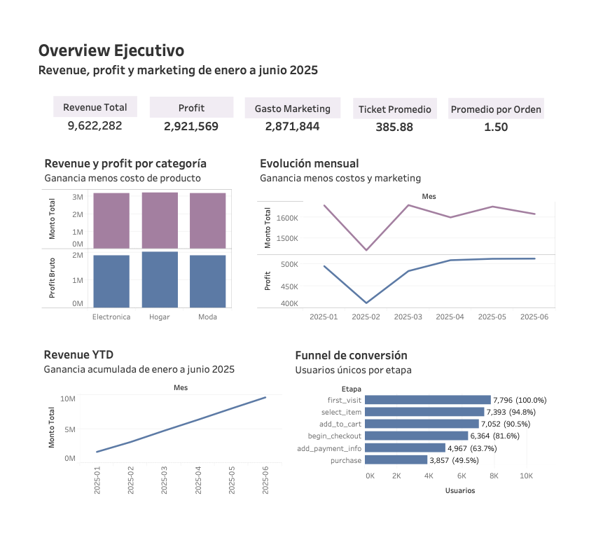

# RappiPlus: Rentabilidad, funnel y experimento A/B

Caso de negocio simulado del bootcamp de Data Analytics de TripleTen. Los datos son ficticios.

## Pregunta de negocio
¿Dónde se pierden los usuarios y qué productos y canales dejan ganancia?

## Hallazgos principales
- El negocio es rentable: de 9.62 millones de revenue quedan 2.92 millones de profit (30.4%). El marketing pesa cerca del 30% del ingreso.
- La mayor fuga del funnel está en el checkout: solo 49.47% de los usuarios compra, y 22% se pierde entre iniciar el checkout y dejar los datos de pago.
- Laptop-Gaming-16GB se vende por debajo de su costo (profit bruto de −93,622).
- El cambio de interfaz probado en el A/B no mostró efecto significativo (p = 0.4161).

## Qué hice
1. Calidad de datos en Python (limpieza, duplicados, nulos y fechas).
2. Rentabilidad: revenue, costos, marketing y profit por producto.
3. Funnel estricto de conversión con SQL.
4. Retención por cohortes con SQL.
5. Prueba z de proporciones para el experimento A/B.
6. Dashboard ejecutivo en Tableau.

## Herramientas
Python (pandas, NumPy, seaborn, Matplotlib, statsmodels) · SQL (PostgreSQL con SQLAlchemy) · Tableau

## Dashboard
[Ver en Tableau Public](https://public.tableau.com/views/Dashboard_RappiPlus/OverviewEjecutivo)

## Contenido
- `rappiplus-analysis.ipynb`: análisis completo.

## Nota
Los datos pertenecen al bootcamp y no se incluyen. Las celdas de SQL requieren credenciales de TripleTen, que se omitieron en esta versión pública.
